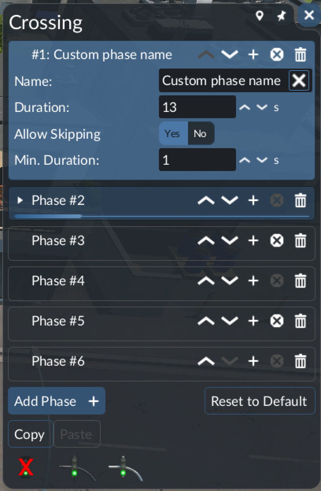

# Traffic Light UI enhancer

A Transport Fever 3 mod that improves the traffic light phase editor at crossings.

## Features

- **Reorder phases:** move a phase up or down instead of deleting and re-adding it.
- **Insert below:** add a new phase (all lanes red) directly below any existing phase.
- **Rename phases:** custom names are shown in the phase list (`#1: My name`).
- **Exact durations:** Duration and Min. Duration use whole-number inputs with +1/-1 buttons instead of sliders.
  Min. Duration is capped at the phase duration and only editable when skipping is allowed.
- **Copy & paste phases:** copy the phase setup (lanes, durations, skipping, names) of one intersection and paste it onto
  another. Lanes are matched by road direction, so the target may be rotated or have different lane numbering, but it
  needs the same number of roads. Unmatched lanes and crosswalks stay red. The clipboard is kept until the game is
  restarted.

## Settings

- **Debug log** (mod parameter, off by default): writes diagnostic lines to `stdout.txt`, e.g. how copy & paste matched
  the roads and crosswalks of an intersection.

## Known limitations

- **Phase names are lost when the mod is removed.** Names are stored in the savegame by the mod's game script.
  Loading a save without the mod drops that state (`Removing entity … for GameScript …/phase_names.gs which is no
  longer available` in `stdout.txt`); re-adding the mod does not bring the names back. Phase order, durations and
  all other settings are stored in the game's own traffic light data and stay intact.

## Installation

- **mod.io:** subscribe in the in-game mod browser.
- **Local:** copy `src/traffic_light_ui_enhancement` to the mod directory of the game and enable the mod.
